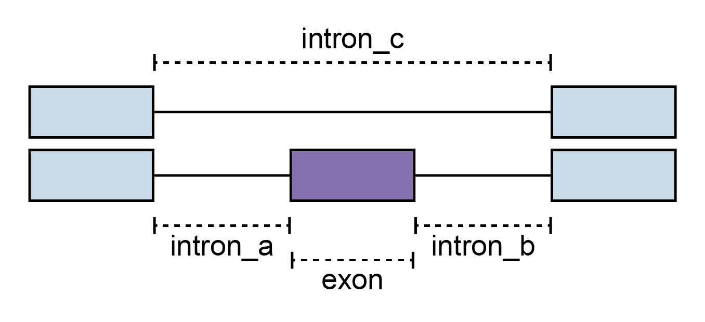
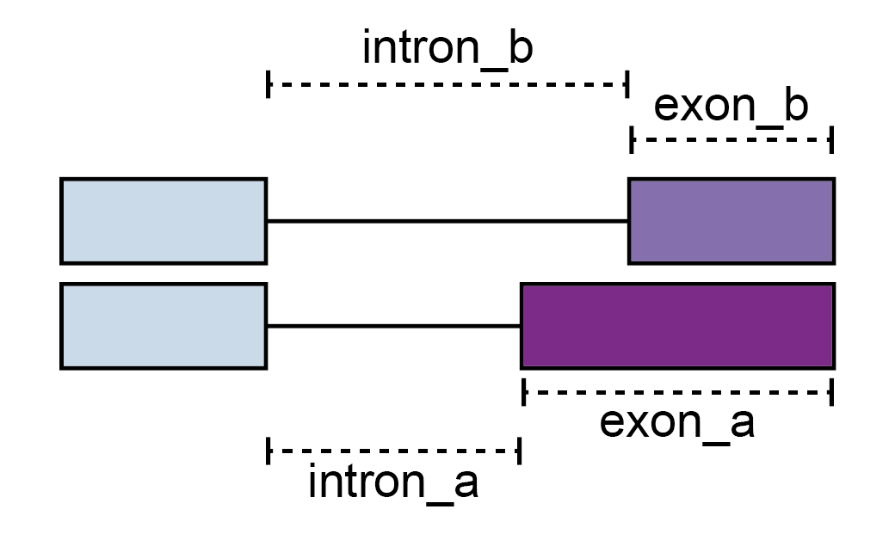
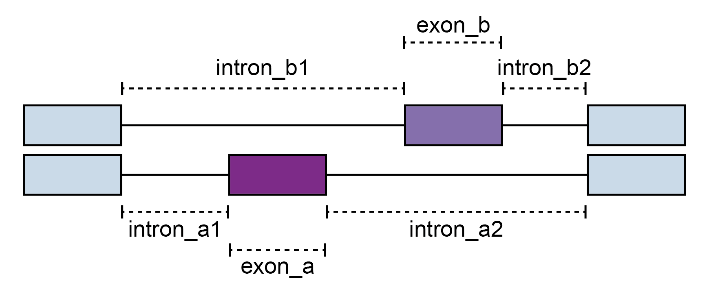
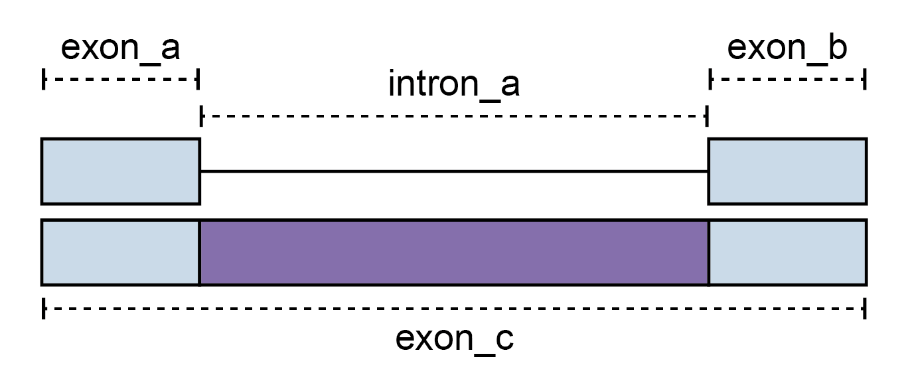
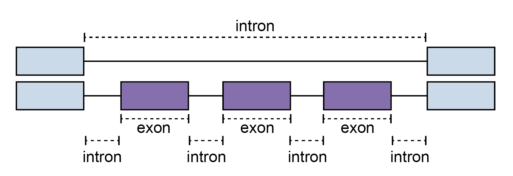
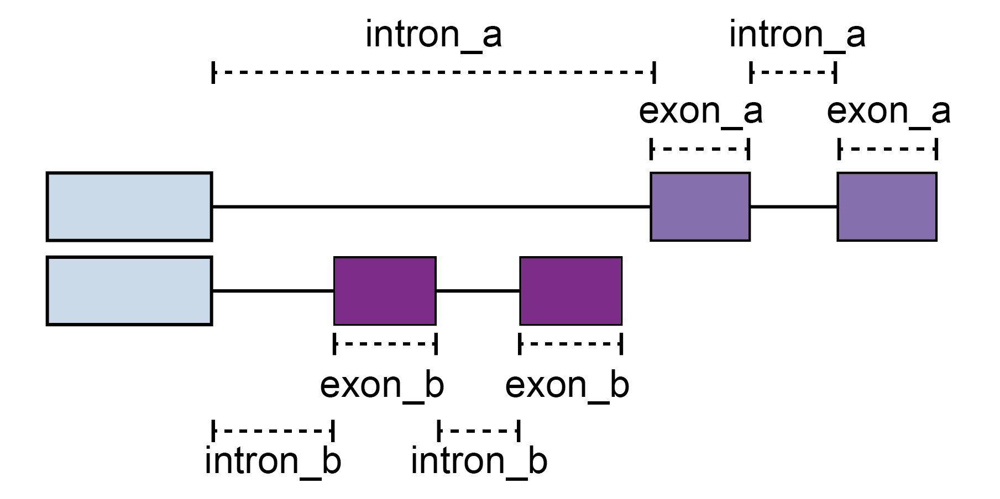

# Output files of Shiba/SnakeShiba

This page describes **Fisher-mode** result columns. For `stat_method: beta_binomial`,
use the [complete regression output reference](../usage/beta_binomial_regression.md#output);
the two modes have different result schemas.

The output directory of **Shiba** contains the following sub directories:

- `annotation`: Assembled GTF file, only when unannotated-event discovery is enabled.
- `events`: Text files of alternative splicing events.
- `junctions`: Junction read counts.
- `results`: Results of differential expression and splicing analysis.
- `plots`: Interactive `summary.html`, individual figure HTMLs, and PNG/PDF/SVG exports.
- `report.json`: Pipeline command, version, inputs, and execution timing.

The following sub directories are added when **SnakeShiba** is used:

- `benchmark`: [Benchmarking](https://snakemake.readthedocs.io/en/stable/tutorial/additional_features.html) results.
- `log`: Log files of each step.

---

## Files in `results/splicing`

- `PSI_[SE,FIVE,THREE,MXE,RI,MSE,AFE,ALE].txt`: Results of differential splicing analysis.
- `PSI_matrix_[sample,group].txt`: PSI values of each event for all samples or groups. Blank cells indicate that the event did not pass the minimum read count threshold.
- `analysis.json`: Method and analysis settings.
- `results.xlsx`: Optional Excel export.
- `summary.txt`: Numbers of the differentially spliced events for each splicing and event type.

---

## Column description of PSI_*.txt

- **event_id**: ID of the event.
- **pos_id**: Positional ID of the event. This is useful for comparing the same event across different **Shiba** runs.
- **strand**: Strand of the event (*+* or *-*).
- **gene_id**: Gene ID.
- **gene_name**: Gene name.
- **label**: Label of the event type (*annotated* or *unannotated*). *annotated* means that the event is documented in the reference annotation file, while *unannotated* means that the event is NOT documented in the reference annotation file (i.e. novel or cryptic splicing event).
- **ref_PSI**: PSI of the reference group.
- **alt_PSI**: PSI of the alternative group.
- **dPSI**: Delta PSI (alt_PSI - ref_PSI).
- **q**: *P*-value of Fisher's exact test adjusted by the Benjamini-Hochberg method.
- **Diff events**: Flag of if the event is differentially spliced between the reference and alternative groups (*Yes* or *No*).

---

## `PSI_SE.txt`

<figure markdown="span">
	{ width="100%" }
	<figcaption>Skipped exon</figcaption>
</figure>

- **exon**: Genomic coordinates of the skipped exon.
- **intron_a**: Genomic coordinates of the left-side inclusive intron of the skipped exon.
- **intron_b**: Genomic coordinates of the right-side inclusive intron of the skipped exon.
- **intron_c**: Genomic coordinates of the exclusive intron of the skipped exon.
- **ref_junction_a**: Junction read counts of the left-side inclusive intron of the skipped exon in the reference group.
- **ref_junction_b**: Junction read counts of the right-side inclusive intron of the skipped exon in the reference group.
- **ref_junction_c**: Junction read counts of the exclusive intron of the skipped exon in the reference group.
- **alt_junction_a**: Junction read counts of the left-side inclusive intron of the skipped exon in the alternative group.
- **alt_junction_b**: Junction read counts of the right-side inclusive intron of the skipped exon in the alternative group.
- **alt_junction_c**: Junction read counts of the exclusive intron of the skipped exon in the alternative group.
- **OR_junction_a**: Odds ratio comparing junction read counts of the left-side inclusive intron to those of the exclusive intron, reference group against alternative group.
- **p_junction_a**: *P*-value of Fisher's exact test for the junction read counts of the left-side inclusive intron to those of the exclusive intron, reference group against alternative group.
- **OR_junction_b**: Odds ratio comparing junction read counts of the right-side inclusive intron to those of the exclusive intron, reference group against alternative group.
- **p_junction_b**: *P*-value of Fisher's exact test for the junction read counts of the right-side inclusive intron to those of the exclusive intron, reference group against alternative group.
- **p_maximum**: Greater of the two *P*-values of Fisher's exact tests.

---

## `PSI_FIVE.txt` and `PSI_THREE.txt`

<figure markdown="span">
	{ width="100%" }
	<figcaption>Alternative 5' and 3' splice sites</figcaption>
</figure>

- **exon_a**: Genomic coordinates of the longer exon using more internal splice site.
- **exon_b**: Genomic coordinates of the shorter exon using less internal splice site.
- **intron_a**: Genomic coordinates of the intron associated with the longer exon.
- **intron_b**: Genomic coordinates of the intron associated with the shorter exon.
- **ref_junction_a**: Junction read counts of the intron associated with the longer exon in the reference group.
- **ref_junction_b**: Junction read counts of the intron associated with the shorter exon in the reference group.
- **alt_junction_a**: Junction read counts of the intron associated with the longer exon in the alternative group.
- **alt_junction_b**: Junction read counts of the intron associated with the shorter exon in the alternative group.
- **OR**: Odds ratio comparing junction read counts of the intron associated with the longer exon to those of the intron associated with the shorter exon, reference group against alternative group.
- **p**: *P*-value of Fisher's exact test for the junction read counts of the intron associated with the longer exon to those of the intron associated with the shorter exon, reference group against alternative group.

---

## `PSI_MXE.txt`

<figure markdown="span">
	{ width="100%" }
	<figcaption>Mutually exclusive exons</figcaption>

Exon A/B follow transcript orientation; on the minus strand, A is not the leftmost exon. Junctions a1/b1 are upstream (5′) and a2/b2 are downstream (3′) of their respective exon in transcript orientation.
</figure>

- **exon_a**: Genomic coordinates of the upstream mutually exclusive exon (in transcript orientation).
- **exon_b**: Genomic coordinates of the downstream mutually exclusive exon (in transcript orientation).
- **intron_a1**: Genomic coordinates of the upstream (5′) inclusive intron of the upstream mutually exclusive exon (in transcript orientation).
- **intron_a2**: Genomic coordinates of the downstream (3′) inclusive intron of the upstream mutually exclusive exon (in transcript orientation).
- **intron_b1**: Genomic coordinates of the upstream (5′) inclusive intron of the downstream mutually exclusive exon (in transcript orientation).
- **intron_b2**: Genomic coordinates of the downstream (3′) inclusive intron of the downstream mutually exclusive exon (in transcript orientation).
- **ref_junction_a1**: Junction read counts of the upstream (5′) inclusive intron of the upstream mutually exclusive exon (in transcript orientation) in the reference group.
- **ref_junction_a2**: Junction read counts of the downstream (3′) inclusive intron of the upstream mutually exclusive exon (in transcript orientation) in the reference group.
- **ref_junction_b1**: Junction read counts of the upstream (5′) inclusive intron of the downstream mutually exclusive exon (in transcript orientation) in the reference group.
- **ref_junction_b2**: Junction read counts of the downstream (3′) inclusive intron of the downstream mutually exclusive exon (in transcript orientation) in the reference group.
- **alt_junction_a1**: Junction read counts of the upstream (5′) inclusive intron of the upstream mutually exclusive exon (in transcript orientation) in the alternative group.
- **alt_junction_a2**: Junction read counts of the downstream (3′) inclusive intron of the upstream mutually exclusive exon (in transcript orientation) in the alternative group.
- **alt_junction_b1**: Junction read counts of the upstream (5′) inclusive intron of the downstream mutually exclusive exon (in transcript orientation) in the alternative group.
- **alt_junction_b2**: Junction read counts of the downstream (3′) inclusive intron of the downstream mutually exclusive exon (in transcript orientation) in the alternative group.
- **OR_junction_a1b1**: Odds ratio comparing junction read counts of the upstream (5′) inclusive intron of the upstream mutually exclusive exon (in transcript orientation) to those of the upstream (5′) inclusive intron of the downstream mutually exclusive exon (in transcript orientation), reference group against alternative group.
- **p_junction_a1b1**: *P*-value of Fisher's exact test for the junction read counts of the upstream (5′) inclusive intron of the upstream mutually exclusive exon (in transcript orientation) to those of the upstream (5′) inclusive intron of the downstream mutually exclusive exon (in transcript orientation), reference group against alternative group.
- **OR_junction_a1b2**: Odds ratio comparing junction read counts of the upstream (5′) inclusive intron of the upstream mutually exclusive exon (in transcript orientation) to those of the downstream (3′) inclusive intron of the downstream mutually exclusive exon (in transcript orientation), reference group against alternative group.
- **p_junction_a1b2**: *P*-value of Fisher's exact test comparing junction read counts of the upstream (5′) inclusive intron of the upstream mutually exclusive exon (in transcript orientation) to those of the downstream (3′) inclusive intron of the downstream mutually exclusive exon (in transcript orientation), reference group against alternative group.
- **OR_junction_a2b1**: Odds ratio comparing junction read counts of the downstream (3′) inclusive intron of the upstream mutually exclusive exon (in transcript orientation) to those of the upstream (5′) inclusive intron of the downstream mutually exclusive exon (in transcript orientation), reference group against alternative group.
- **p_junction_a2b1**: *P*-value of Fisher's exact test comparing junction read counts of the downstream (3′) inclusive intron of the upstream mutually exclusive exon (in transcript orientation) to those of the upstream (5′) inclusive intron of the downstream mutually exclusive exon (in transcript orientation), reference group against alternative group.
- **OR_junction_a2b2**: Odds ratio comparing junction read counts of the downstream (3′) inclusive intron of the upstream mutually exclusive exon (in transcript orientation) to those of the downstream (3′) inclusive intron of the downstream mutually exclusive exon (in transcript orientation), reference group against alternative group.
- **p_junction_a2b2**: *P*-value of Fisher's exact test comparing junction read counts of the downstream (3′) inclusive intron of the upstream mutually exclusive exon (in transcript orientation) to those of the downstream (3′) inclusive intron of the downstream mutually exclusive exon (in transcript orientation), reference group against alternative group.
- **p_maximum**: Greater of the four *P*-values of Fisher's exact tests.

---

## `PSI_RI.txt`

<figure markdown="span">
	{ width="100%" }
	<figcaption>Retained intron</figcaption>
</figure>

- **exon_a**: Genomic coordinates of the left-side exon.
- **exon_b**: Genomic coordinates of the right-side exon.
- **exon_c**: Genomic coordinates of the exon containing the retained intron.
- **intron_a**: Genomic coordinates of the retained intron.
- **ref_junction_a**: Junction read counts of the intron in the reference group.
- **ref_junction_a_start**: The left-side exon-intron junction read counts of the retained intron in the reference group.
- **ref_junction_a_end**: The right-side exon-intron junction read counts of the retained intron in the reference group.
- **alt_junction_a**: Junction read counts of the intron in the alternative group.
- **alt_junction_a_start**: The left-side exon-intron junction read counts of the retained intron in the alternative group.
- **alt_junction_a_end**: The right-side exon-intron junction read counts of the retained intron in the alternative group.
- **OR_junction_a_start**: Odds ratio comparing the left-side exon-intron junction read counts to the intron junction read counts, reference group against alternative group.
- **p_junction_a_start**: *P*-value of Fisher's exact test for the left-side exon-intron junction read counts to the intron junction read counts, reference group against alternative group.
- **OR_junction_a_end**: Odds ratio comparing the right-side exon-intron junction read counts to the intron junction read counts, reference group against alternative group.
- **p_junction_a_end**: *P*-value of Fisher's exact test for the right-side exon-intron junction read counts to the intron junction read counts, reference group against alternative group.
- **p_maximum**: Greater of the two *P*-values of Fisher's exact tests.

---

## `PSI_MSE.txt`

<figure markdown="span">
	{ width="100%" }
	<figcaption>Multiple skipped exons</figcaption>
</figure>

- **mse_n**: Number of skipped exons.
- **exon**: Genomic coordinates of the skipped exons, separated by semi-colons from the left to the right (e.g., `chr1:75790152-75790274;chr1:75790446-75790517`).
- **intron**: Genomic coordinates of the associated introns of the skipped exons, separated by semi-colons from the left to the right and the last one is the exclusive intron (e.g., `chr1:75790057-75790152;chr1:75790274-75790446;chr1:75790517-75791285;chr1:75790057-75791285`).
- **ref_junction**: Junction read counts of the associated introns of the skipped exons in the reference group, separated by semi-colons from the left to the right and the last one is the exclusive intron (e.g., `25;20;32;489`).
- **alt_junction**: Junction read counts of the associated introns of the skipped exons in the alternative group, separated by semi-colons from the left to the right and the last one is the exclusive intron (e.g., `386;438;703;598`).
- **OR_junction**: Odds ratio comparing junction read counts of the associated inclusive introns of the skipped exons to those of the exclusive intron, reference group against alternative group, separated by semi-colons from the left to the right (e.g., `0.07920361952594382;0.05584036006760605;0.055665610718888085`).
- **p_junction**: *P*-value of Fisher's exact test for the junction read counts of the associated inclusive introns of the skipped exons to those of the exclusive intron, reference group against alternative group, separated by semi-colons from the left to the right (e.g., `3.0283773991245187e-54;2.488569122823104e-66;3.7054604961481054e-93`).

---

## `PSI_AFE.txt` and `PSI_ALE.txt`

<figure markdown="span">
	{ width="100%" }
	<figcaption>Alternative first and last exons</figcaption>
</figure>

- **exon_a**: Genomic coordinates of the distal exons, separated by semi-colons from the distal to the proximal (e.g., `chr11:30267948-30268175;chr11:30219579-30219772`).
- **exon_b**: Genomic coordinates of the proximal exons, separated by semi-colons from the distal to the proximal (e.g., `chr11:30197724-30198257`).
- **intron_a**: Genomic coordinates of the introns associated with the distal exon, separated by semi-colons from the distal to the proximal (e.g., `chr11:30219772-30267948;chr11:30159445-30219579`).
- **intron_b**: Genomic coordinates of the introns associated with the proximal exon, separated by semi-colons from the distal to the proximal (e.g., `chr11:30159445-30197724`).
- **ref_junction_a**: Junction read counts of the introns associated with the distal exon in the reference group, separated by semi-colons from the distal to the proximal (e.g., `184;451`).
- **ref_junction_b**: Junction read counts of the introns associated with the proximal exon in the reference group, separated by semi-colons from the distal to the proximal (e.g., `136`).
- **alt_junction_a**: Junction read counts of the introns associated with the distal exon in the alternative group, separated by semi-colons from the distal to the proximal (e.g., `975;3058`).
- **alt_junction_b**: Junction read counts of the introns associated with the proximal exon in the alternative group, separated by semi-colons from the distal to the proximal (e.g., `4`).
- **OR_junction**: Odds ratio comparing junction read counts of the introns associated with the distal exon to those of the introns associated with the proximal exon, reference group against alternative group, separated by semi-colons from the distal to the proximal. (e.g., `0.00555052790346908;0.0043377063055438005`).
- **p_junction**: *P*-value of Fisher's exact test for the junction read counts of the introns associated with the distal exon to those of the introns associated with the proximal exon, reference group against alternative group, separated by semi-colons from the distal to the proximal (e.g., `3.952031792878382e-88;5.615960667265659e-108`).

---

## when `ttest` is `true`

- <sample\>_PSI: PSI of the sample. Blank cells indicate that the event did not pass the minimum read count threshold.
- p_ttest: *P*-value of Welch's t-test for the PSI of the reference and alternative groups. Please note that the *P*-value is not adjusted for multiple testing.

---

## Files in `results/expression`

- `counts.txt`: Read counts for all samples.
- `TPM.txt`: TPM values for all samples.
- `CPM.txt`: CPM values for all samples.
- `DEG.txt`: Results of differential expression analysis by [DESeq2](https://www.bioconductor.org/packages/release/bioc/vignettes/DESeq2/inst/doc/DESeq2.html).

---

## Files in `results/pca`

- `tpm_pca.tsv`: Principal components for TPM matrix.
- `tpm_contribution.tsv`: Contribution to each principal component for TPM matrix.
- `psi_pca.tsv`: Principal components for PSI matrix.
- `psi_contribution.tsv`: Contribution to each principal component for PSI matrix.

---

## Interactive plots

`plots/summary.html` embeds the interactive figures and their data in one file.
It contains the analysis command, event-count summary, TPM/PSI PCA, and volcano
and PSI scatter plots for eight event types. Static exports are in `png/`,
`pdf/`, and `svg/`; `interactive/` holds HTML fragments, while `data/`
holds standalone PCA/scatter/volcano pages. See the
[shared report behavior](../usage/beta_binomial_regression.md#reading-results-and-reports).

## An example of output directory structure

This is a full Fisher run; optional annotation, Excel, and expression-test
outputs depend on configuration. `--mame` omits expression, PCA, and plots.
PSI-only bulk runs omit plots and differential tests.

```text
workdir/
├── annotation/assembled_annotation.gtf
├── events/EVENT_<TYPE>.txt
├── junctions/junctions.bed
├── plots/
│   ├── summary.html
│   ├── data/
│   ├── interactive/
│   ├── png/
│   ├── pdf/
│   └── svg/
├── results/
│   ├── expression/
│   │   ├── counts.txt
│   │   ├── TPM.txt
│   │   ├── CPM.txt
│   │   ├── DEG.txt
│   │   └── TPM_CPM.xlsx
│   ├── pca/
│   │   ├── tpm_pca.tsv
│   │   ├── tpm_contribution.tsv
│   │   ├── psi_pca.tsv
│   │   └── psi_contribution.tsv
│   └── splicing/
│       ├── analysis.json
│       ├── PSI_<TYPE>.txt
│       ├── PSI_matrix_sample.txt
│       ├── PSI_matrix_group.txt
│       ├── summary.txt
│       └── results.xlsx
└── report.json
```
